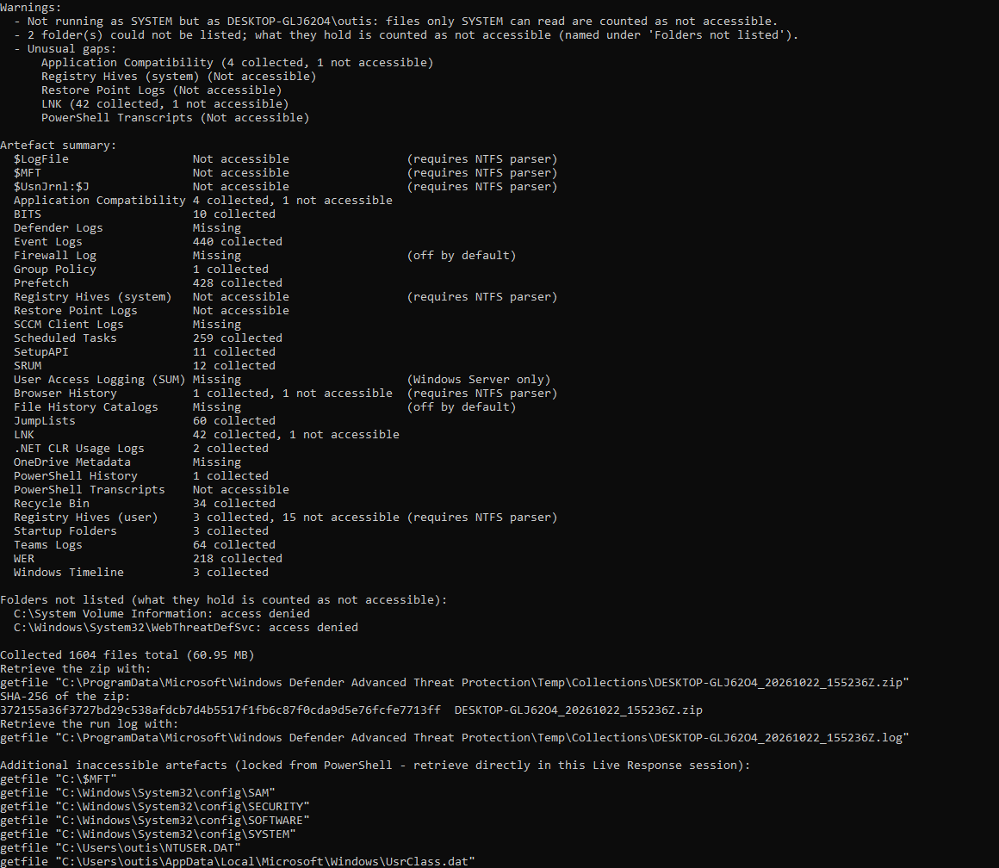
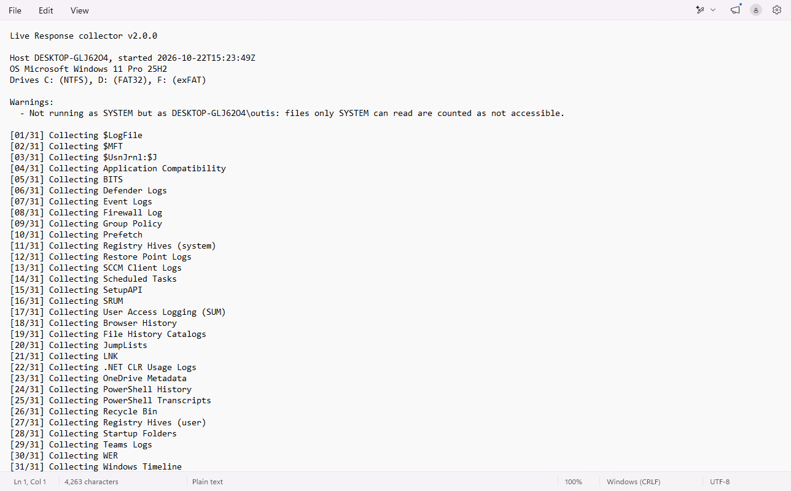
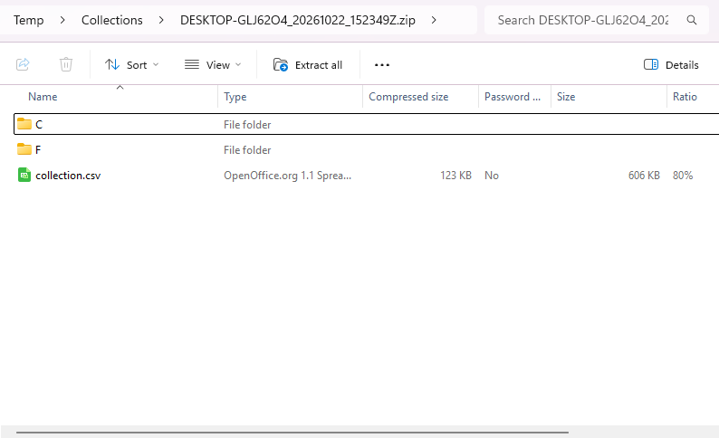
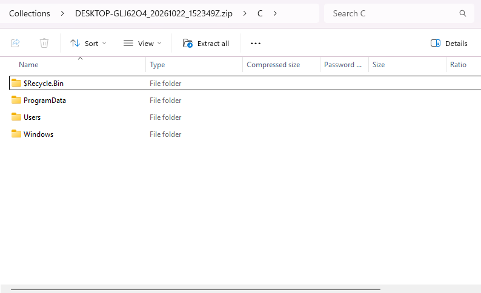

# defender-live-response-collector

A single, self-contained PowerShell script for forensic triage collection
(incident response / DFIR) through **Microsoft Defender for Endpoint (MDE)
Live Response**. Upload it to the Live Response library, run it on a Windows
device, and pull back one zip of timeline-relevant forensic artefacts
(artifacts), with its SHA-256 - no binaries to upload.

**The problem it solves:**

- **`getfile` is one file at a time**, with no wildcards or folders. Pulling
  event logs, Prefetch, registry hives, LNK files, JumpLists and browser
  history for every user means hundreds of individual `getfile` commands. This
  script gathers them into one zip in a single `run`, so you need one
  `getfile` per zip volume (plus a short, printed list of ready-to-paste
  commands for the few locked files it can't read).
- **Full collectors need binaries and supporting files.** Staging KAPE or a
  Velociraptor collector through Live Response means uploading and running
  executables, which is not always possible or permitted. A multi-file toolkit
  can collect more; this script aims to do as much as one script can, for when
  a script is all you can run.
- **The built-in investigation package falls short for timelining.** Defender's
  *Collect investigation package* is a point-in-time snapshot of system state
  (processes, services, network connections, autoruns), much of it exported as
  text or CSV rather than raw artefacts. It omits key timeline sources such as
  registry hives, Amcache, SRUM, LNK files, JumpLists, browser history and most
  event logs. This script collects those raw, ready for your own parsers.

It is a **lightweight, best-effort first pass**, for when all you have is a
Live Response session. It uses ordinary file reads only, with **no raw disk
access (no NTFS parser) and no Volume Shadow Copy**. It copies what Windows lets
it open, says exactly what it couldn't, and moves on. For a comprehensive
collection, including locked files and raw NTFS artefacts, use a full
collector such as KAPE or the Velociraptor Offline Collector.

<table>
  <tr>
    <td></td>
    <td></td>
  </tr>
  <tr>
    <td></td>
    <td></td>
  </tr>
</table>

A run as an administrator on a test machine (Live Response runs it as SYSTEM,
so its warning that the run isn't SYSTEM doesn't appear there).

## Table of contents

- [What it does](#what-it-does)
- [Install](#install)
- [Usage](#usage)
- [What it collects](#what-it-collects)
- [What it can't collect](#what-it-cant-collect)
- [How it works](#how-it-works)
- [Reading the summary](#reading-the-summary)
- [What the output shows](#what-the-output-shows)
- [What it does not do](#what-it-does-not-do)
- [Contributing](#contributing)
- [Licence](#licence)

## What it does

- **Collects 28 timeline-relevant artefacts** in one run, and lists `$MFT`
  for `getfile` (31 summary lines with the other two NTFS metafiles): event
  logs, Prefetch, Amcache and PCA, registry hives, SRUM, BITS, scheduled tasks,
  LNK files and JumpLists, browser history for every maintained browser,
  Recycle Bin `$I` records, PowerShell history and transcripts, Defender,
  OneDrive, Teams and Configuration Manager logs, and more
  ([What it collects](#what-it-collects)).
- **Timeline value first.** Artefacts are chosen for timestamped evidence of
  execution, file access, persistence, device use, browsing and command-line
  activity. Windows-native sources only, plus browser history; metadata over
  content (`$I` records, not the deleted `$R` files; `.wer` reports, not memory
  dumps; browser history, not caches).
- **Legacy forms included.** Older-Windows forms of each artefact (e.g. `.evt`,
  `RecentFileCache.bcf`, XP profile paths) and the previous install kept in
  `Windows.old` are collected as part of the same artefact.
- **Every local drive** for per-drive artefacts (Recycle Bin, and `$MFT` for
  `getfile`): fixed or removable, NTFS, FAT or exFAT.
- **SHA-256 of the zip** (or of each volume), printed under its `getfile`
  lines in `sha256sum` format, so the download can be checked.
- **A per-file record**, `collection.csv` at the zip's root: one row per file
  attempted, with its outcome, size, bytes copied, the SHA-256 of the bytes in
  the zip, and its created, modified and accessed times (UTC), and one per
  folder that couldn't be listed.
- **Says what it couldn't collect, and why.** One Warnings section, a summary
  line per artefact with the reason where a gap is normal for the host, the
  folders it couldn't list and the copies that changed or failed part-way, and
  ready-to-paste `getfile` commands for locked files the Defender sensor can
  fetch.
- **A run log** beside the zip, with everything the console showed.
- **Split volumes** for a zip over 1 GiB, so each `getfile` stays well within
  Live Response's limits.
- **Nothing but Windows PowerShell 5.1:** no modules, no downloads, no child
  processes.

## Install

```powershell
# Download collector.ps1 from the latest release, then check it against the
# SHA-256 in the release notes:
Get-FileHash .\collector.ps1 -Algorithm SHA256
```

Latest release: https://github.com/rbqbjyur/defender-live-response-collector/releases/latest

Upload `collector.ps1` to the Live Response library in the Defender portal.
The script is unsigned: either enable *Allow unsigned script execution* in the
Live Response settings for your tenant, or sign it with your own code-signing
certificate.

### Requirements

- Windows PowerShell 5.1 on the device: it runs where Live Response and
  Windows PowerShell 5.1 run. The XP and Windows 7 forms it collects are
  found on disks and in `Windows.old` of newer installs.
- Microsoft Defender for Endpoint Live Response, which runs the script as
  SYSTEM. Run any other way, files only SYSTEM can read are counted as not
  accessible, and the run says so in its Warnings.
- Free space on the system drive for the zip, above a 1 GiB reserve left for
  the host (and one volume more when it is split).

## Usage

```
run collector.ps1
```

No parameters. When it finishes, it prints the commands to retrieve its
output in the same session:

```
Retrieve the zip with:
getfile "C:\ProgramData\Microsoft\Windows Defender Advanced Threat Protection\Temp\Collections\<HOSTNAME>_<yyyyMMdd_HHmmss>Z.zip"
SHA-256 of the zip:
<sha-256>  <HOSTNAME>_<yyyyMMdd_HHmmss>Z.zip
Retrieve the run log with:
getfile "C:\ProgramData\Microsoft\Windows Defender Advanced Threat Protection\Temp\Collections\<HOSTNAME>_<yyyyMMdd_HHmmss>Z.log"
```

- A zip over 1 GiB comes as `.zip.001`, `.zip.002`, ... with one `getfile`
  line and one SHA-256 line each: open `.001` in 7-Zip or concatenate them.
- `getfile` may deliver a file gzip-wrapped (`.gz`); the zip inside is
  unchanged, and the SHA-256 is the zip's.
- If it lists **Additional inaccessible artefacts**, those are files
  PowerShell could not read (e.g. `$MFT`, locked hives): paste the printed
  `getfile` lines into the same session to retrieve them through the Defender
  sensor.
- `collection.csv`, at the zip's root, is the per-file record: every file
  collected or found but not readable, with its outcome (`collected`,
  `size changed`, `incomplete`, `not accessible`, `not local`), size, bytes
  copied, SHA-256, times and, for a failure, the error; every folder that
  couldn't be listed (`folder not listed`, with the reason); any artefact
  whose collection failed as a whole (`artefact failed`); and, in a partial
  collection, the artefacts the run didn't reach (`not collected`).
- `getfile` lines are printed only for a complete output: the whole zip, or
  every one of its volumes. A run that stopped to keep the free-space reserve
  prints none (see [How it works](#how-it-works)).

## What it collects

These are the locations it attempts, in the order the script runs them (the
NTFS metafiles that open the summary are covered under
[What it can't collect](#what-it-cant-collect)). Anything locked is skipped
and counted.

- `<user>` is every folder under `C:\Users` (and, on XP-era layouts,
  `C:\Documents and Settings`). A profile the registry's ProfileList places
  elsewhere (e.g. on another drive) is not searched; it is named under
  Warnings.
- `<sysprof>` is `C:\Windows\System32\config\systemprofile` (the SYSTEM
  account). Service accounts are not `<user>`; their locations are listed
  explicitly.
- `<profile>` is any browser profile folder.
- Within each artefact, locations run from current Windows to legacy forms and
  then `Windows.old`.
- Folder junctions and symbolic links are not followed, including Windows' own
  compatibility links (`Default User`, `All Users`, `Documents and Settings`);
  they only point back to folders already covered. File symbolic links are
  not followed either.
- Empty (0-byte) files and file symbolic links are left out of the zip, of
  `collection.csv` and of every count.
- Paths are resolved from `%SystemDrive%`, so non-`C:` installs work too.
- Per-drive artefacts (Recycle Bin, and the NTFS metafiles under
  [What it can't collect](#what-it-cant-collect)) are taken from every local
  drive, fixed or removable (NTFS, FAT or exFAT), e.g. `C:`, `D:` and a USB
  drive; network drives are not.
- Inside the zip, files keep their original path
  (e.g. `C/Windows/Prefetch/...`), including names that end with a dot or a
  space; `collection.csv` sits at the root beside the drive folders.

| Artefact | Location |
|---|---|
| Application Compatibility | `C:\Windows\AppCompat\Programs\Amcache.hve`<br>`C:\Windows\appcompat\pca\*` (Windows 11 22H2+)<br>`C:\Windows\AppCompat\Programs\RecentFileCache.bcf` (Windows 7)<br>`C:\System Volume Information\Syscache.hve` (Windows 7 / Server 2008 R2)<br>`C:\Windows.old\Windows\AppCompat\Programs\{Amcache.hve,RecentFileCache.bcf}`<br>hives with their `.LOG1`/`.LOG2` |
| BITS | `C:\ProgramData\Microsoft\Network\Downloader\` (recursive) |
| Defender Logs | `C:\ProgramData\Microsoft\Windows Defender\Support\` (recursive)<br>`C:\ProgramData\Microsoft\Windows Defender\Scans\History\Service\DetectionHistory\` (recursive)<br>`C:\ProgramData\Microsoft\Windows Defender\Scans\History\Service\Detections.log`<br>`C:\Windows\Temp\MpCmdRun.log`<br>`C:\ProgramData\Microsoft\Microsoft AntiMalware\Support\` (recursive; older Defender / SCEP)<br>`C:\Windows.old\Windows\Temp\MpCmdRun.log` |
| Event Logs | `C:\Windows\System32\winevt\logs\*.evtx`<br>`C:\Windows\System32\config\*.evt` (XP)<br>`C:\Windows.old\Windows\System32\winevt\logs\*.evtx` |
| Firewall Log | `C:\Windows\System32\LogFiles\Firewall\pfirewall.*`<br>`C:\Windows.old\Windows\System32\LogFiles\Firewall\pfirewall.*` |
| Group Policy | `C:\Windows\System32\GroupPolicy\` (recursive)<br>`C:\ProgramData\Microsoft\Group Policy\History\` (recursive; cached domain GPOs)<br>`<user>\AppData\Local\Microsoft\Group Policy\History\` (recursive)<br>`C:\Windows.old\Windows\System32\GroupPolicy\` `*.ini`, `*.pol` and `*\Scripts\` (recursive) |
| Prefetch | `C:\Windows\Prefetch\*.pf`<br>`C:\Windows.old\Windows\Prefetch\*.pf` |
| Registry Hives (system) | `C:\Windows\System32\config\{SAM,SECURITY,SOFTWARE,SYSTEM}`<br>`C:\Windows\System32\config\RegBack\{SAM,SECURITY,SOFTWARE,SYSTEM,SYSTEM1}`<br>`C:\System Volume Information\_restore*\RP*\snapshot\_REGISTRY_*` (XP restore points)<br>`C:\Windows.old\Windows\System32\config\` and `...\config\RegBack\`, same hives<br>each with its `.LOG1`/`.LOG2` |
| Restore Point Logs | `C:\System Volume Information\_restore*\RP*\rp.log` (XP) |
| SCCM Client Logs | `C:\Windows\CCM\Logs\*` |
| Scheduled Tasks | `C:\Windows\{System32,SysWOW64}\Tasks\` (recursive)<br>`<user>\AppData\Local\Microsoft\Windows\PowerShell\ScheduledJobs\` (recursive)<br>`C:\Windows\{System32,SysWOW64}\config\systemprofile\AppData\Local\Microsoft\Windows\PowerShell\ScheduledJobs\` (recursive)<br>`C:\Windows\Tasks\*.job`, `C:\Windows\SchedLgU.txt` (legacy)<br>`C:\Windows.old\Windows\System32\Tasks\` (recursive), `C:\Windows.old\Windows\Tasks\*.job`, `C:\Windows.old\Windows\SchedLgU.txt` |
| SetupAPI | `C:\Windows\INF\setupapi*.log`<br>`C:\Windows\setupapi.log` (XP)<br>`C:\Windows.old\Windows\INF\setupapi*.log` |
| SRUM | `C:\Windows\System32\SRU\` (recursive: `SRUDB.dat` and its ESE logs)<br>`C:\Windows.old\Windows\System32\SRU\` (recursive) |
| User Access Logging (SUM) | `C:\Windows\System32\LogFiles\Sum\` (recursive; Windows Server) |
| Browser History | `<user>\AppData\Local\Microsoft\{Edge,Edge Beta,Edge Dev,Edge SxS}\User Data\<profile>\History*`<br>`<user>\AppData\Local\Google\{Chrome,Chrome Beta,Chrome Dev,Chrome SxS}\User Data\<profile>\History*`<br>`<user>\AppData\Local\{Chromium,Vivaldi,Supermium,WaveBrowser}\User Data\<profile>\History*`<br>`<user>\AppData\Local\BraveSoftware\Brave-Browser\User Data\<profile>\History*`<br>`<user>\AppData\Local\Yandex\YandexBrowser\User Data\<profile>\History*`<br>`<user>\AppData\Local\CocCoc\Browser\User Data\<profile>\History*`<br>`<user>\AppData\Local\Tencent\QQBrowser\User Data\<profile>\History*`<br>`<user>\AppData\Local\Palo Alto Networks\PrismaAccessBrowser\User Data\<profile>\History*`<br>`<user>\AppData\Local\Packages\TheBrowserCompany.Arc_ttt1ap7aakyb4\LocalCache\Local\Arc\User Data\<profile>\History*`<br>`<user>\AppData\Roaming\Opera Software\Opera Stable\History*` and `...\Opera Stable\<profile>\History*`<br>`<user>\AppData\Roaming\360se6\User Data\<profile>\360History*`<br>`<user>\AppData\Roaming\Mozilla\Firefox\Profiles\<profile>\places.sqlite*`<br>`<sysprof>\AppData\Local\` paths for Chrome (all channels), Chromium, Prisma Access, Supermium and Wave<br>`<user>\AppData\Local\Microsoft\Windows\WebCache\*` (IE 10/11, legacy Edge)<br>`index.dat` under `<user>\AppData\Local\Microsoft\Windows\{History,IEDownloadHistory}\` (recursive; IE 9 and earlier)<br>`<user>\AppData\Roaming\Mozilla\Firefox\Profiles\<profile>\downloads.sqlite*` (Firefox before v26)<br>`<user>\AppData\Roaming\Opera\Opera\{global_history.dat,typed_history.xml}` (Opera 12 and earlier)<br>`<user>\AppData\Roaming\Apple Computer\Safari\History.plist` (Safari for Windows)<br>XP: `<user>\Local Settings\Application Data\` paths for Chrome (all channels), Chromium and Prisma Access; `<user>\Application Data\` paths for Supermium, Firefox (incl. `downloads.sqlite*`), Opera 12 and Safari; `index.dat` under `<user>\Local Settings\History\History.IE5\` (recursive) |
| File History Catalogs | `<user>\AppData\Local\Microsoft\Windows\FileHistory\Configuration\Catalog*.edb` |
| JumpLists | `<user>\AppData\Roaming\Microsoft\Windows\Recent\AutomaticDestinations\*.automaticDestinations-ms`<br>`<user>\AppData\Roaming\Microsoft\Windows\Recent\CustomDestinations\*.customDestinations-ms` |
| LNK | `<user>\AppData\Roaming\Microsoft\Windows\Recent\*.lnk`<br>`<user>\AppData\Roaming\Microsoft\Office\Recent\` (recursive)<br>`<user>\Desktop\*.lnk`<br>`<user>\AppData\Roaming\Microsoft\Windows\Start Menu\Programs\*.lnk`<br>`C:\ProgramData\Microsoft\Windows\Start Menu\Programs\*.lnk`<br>`<user>\Recent\` (recursive; XP)<br>`C:\System Volume Information\_restore*\RP*\*.lnk` (XP restore points) |
| .NET CLR Usage Logs | `<user>\AppData\Local\Microsoft\CLR_*\` (recursive, `*.log`)<br>`<sysprof>\AppData\Local\Microsoft\CLR_*\` (recursive, `*.log`)<br>`C:\Windows.old\Windows\System32\config\systemprofile\AppData\Local\Microsoft\CLR_*\` (recursive, `*.log`) |
| OneDrive Metadata | `<user>\AppData\Local\Microsoft\OneDrive\settings\` (recursive)<br>`<user>\AppData\Local\Microsoft\OneDrive\logs\` (recursive: `*.odl*`, `*.aodl`, `*.loggz`, `*.keystore`; not the `.etlgz` traces)<br>`<user>\AppData\Local\Microsoft\SkyDrive\logs\` (recursive; SkyDrive)<br>`<user>\AppData\Local\Microsoft\Windows\OneDrive\logs\` (recursive; Windows 8.1) |
| PowerShell History | `<user>\AppData\Roaming\Microsoft\Windows\PowerShell\PSReadLine\*_history.txt`<br>`C:\Windows\{System32,SysWOW64}\config\systemprofile\AppData\Roaming\Microsoft\Windows\PowerShell\PSReadLine\*_history.txt` |
| PowerShell Transcripts | `<user>\Documents\PowerShell_transcript.*.txt` and `<user>\Documents\20*\PowerShell_transcript.*.txt`<br>`<user>\OneDrive*\Documents\PowerShell_transcript.*.txt` and `...\Documents\20*\PowerShell_transcript.*.txt`<br>`C:\Windows\{System32,SysWOW64}\*\PowerShell_transcript.*.txt`<br>`C:\PSTranscript\20*\PowerShell_transcript.*.txt`<br>the policy transcription folder, if on a local drive (recursive) |
| Recycle Bin | `<drive>\$Recycle.Bin\<SID>\$I*` on every local drive (FAT/exFAT: `<drive>\$Recycle.Bin\$I*`)<br>`INFO2` under `<drive>\RECYCLE*\` (recursive; XP `RECYCLER`/`RECYCLED`) |
| Registry Hives (user) | `<user>\NTUSER.DAT`<br>`<user>\AppData\Local\Microsoft\Windows\UsrClass.dat`<br>`C:\Windows\System32\config\DEFAULT` (SYSTEM)<br>`<sysprof>\NTUSER.DAT`<br>`C:\Windows\ServiceProfiles\{LocalService,NetworkService}\NTUSER.DAT`<br>`C:\Windows.old\Windows\`, the same four service-account hives<br>each with its `.LOG1`/`.LOG2` |
| Startup Folders | `C:\ProgramData\Microsoft\Windows\Start Menu\Programs\StartUp\` (recursive)<br>`<user>\AppData\Roaming\Microsoft\Windows\Start Menu\Programs\Startup\` (recursive) |
| Teams Logs | `<user>\AppData\Local\Packages\MSTeams_8wekyb3d8bbwe\LocalCache\Microsoft\MSTeams\Logs\*`<br>`<user>\AppData\Local\Packages\MicrosoftTeams_8wekyb3d8bbwe\LocalCache\Microsoft\MSTeams\Logs\*` (Windows 11 built-in Teams)<br>`<user>\AppData\Roaming\Microsoft\Teams\logs.txt` (classic Teams) |
| WER | `C:\ProgramData\Microsoft\Windows\WER\` (recursive, `*.wer`)<br>`<user>\AppData\Local\Microsoft\Windows\WER\` (recursive, `*.wer`) |
| Windows Timeline | `ActivitiesCache.db*` under `<user>\AppData\Local\ConnectedDevicesPlatform\` (recursive; Windows 10) |

## What it can't collect

Some high-value artefacts cannot be read with ordinary file access. Full
collectors such as the Velociraptor Offline Collector read them through raw
volume access with their own NTFS parser, which is out of scope for a single
script that uses only built-in tools. These artefacts appear in the summary as
*Not accessible*. Where the Defender sensor can fetch them, the script prints a
ready-to-paste `getfile` command at the end.

| Artefact | Why | What it would take | Alternative |
|---|---|---|---|
| `$MFT` (each NTFS drive) | NTFS metafile | NTFS parser | `getfile` (printed) |
| `$LogFile` (each NTFS drive) | NTFS metafile | NTFS parser | Not possible via `getfile` (reported as an empty file); Velociraptor Offline Collector |
| `$UsnJrnl:$J` (each NTFS drive) | NTFS metafile (alternate data stream) | NTFS parser | Not possible via `getfile`; Velociraptor Offline Collector |
| File-system metadata of FAT and exFAT drives (allocation table, directory entries) | Not stored as files | FAT/exFAT parser | Not possible via `getfile`; a raw-disk collector |
| System hives (`SAM`, `SECURITY`, `SOFTWARE`, `SYSTEM`) and their transaction logs | Held exclusively by the kernel while loaded | NTFS parser | `getfile` for the hives (printed) |
| SRUM (`SRUDB.dat` and its ESE files) | Sometimes held open by the system (collected when it isn't) | NTFS parser | `getfile` (printed) |
| BITS (`qmgr.db` and its ESE files) | Held by the BITS service while it runs: a demand-start service that stops itself when idle (collected when stopped) | NTFS parser | `getfile` (printed) |
| Service account hives (`DEFAULT`, LocalService and NetworkService `NTUSER.DAT`) and their transaction logs | Loaded while Windows runs | NTFS parser | `getfile` manually (not printed) |
| User Access Logging `Current.mdb` (servers) | Usually held open by the UAL service | NTFS parser | `getfile` (printed) |
| User hives of logged-on users (`NTUSER.DAT`, `UsrClass.dat`) and their transaction logs | Held exclusively while the user is logged on | NTFS parser | `getfile` for the hives (printed) |
| `WebCacheV01.dat` of logged-on users | Usually held open in the user's session | NTFS parser | `getfile` manually (not printed) |

Hives of users who are not logged on, and most other in-use files (EVTX, a
running browser's History), are collected normally. If any other
machine-wide file turns out to be locked, it is added to the printed `getfile`
list (registry transaction logs excepted).

## How it works

- **Best effort.** Anything that can't be read is skipped and counted in the
  summary; the run never stops on an error, except to protect the output or
  the host: a full system drive, free space below the 1 GiB reserve, a zip
  that can't be finished or read back, or a split that fails and can't be
  undone. It then deletes the output and asks you to run it again, with one
  exception: stopped to keep the reserve, the zip of what was collected until
  then is finished, read back and kept, with `collection.csv` naming the
  artefacts not reached (`not collected`, and *Not collected* in the
  summary). It is a partial collection: the Warnings give its path; no
  `getfile` line and no SHA-256 are printed for it.
- **Checked before it is offered.** Once the zip is closed it is read back:
  every entry written must be in its index, with `collection.csv` last.
  Only then is it split, hashed and printed for `getfile`.
- **Cloud-only files.** A file whose content isn't on the disk (a OneDrive
  Files On-Demand placeholder, an offline file) is not read, so nothing is
  downloaded; it is in `collection.csv` as `not local` and counted as not
  accessible.
- **Warnings.** Anything worth a closer look is listed in one Warnings
  section: shown at the start if known by then, and again before the summary
  (or "Warnings: none"). It covers unusual gaps (artefacts that should exist
  on this host but are missing, and unexplained locks), not running as
  SYSTEM, a fallback output folder, folders that couldn't be listed, copies
  that failed part-way, a zip that couldn't be split into volumes, a file over
  `getfile`'s 3 GB limit, a SHA-256 that couldn't be calculated, files not
  read because their content isn't on the disk, user profiles outside the
  folders searched, and a run that had to stop.
- **Fail closed.** A folder that exists but can't be listed counts as *Not
  accessible*, never *Missing*, and is named under the summary. A copy that
  fails part-way stays in the zip, incomplete (a zip can't drop an entry once
  written), and is named under the summary with the bytes copied; so is a
  live file whose size changed while it was copied. Both carry their outcome
  in `collection.csv`.
- **Per-file record.** `collection.csv` is written into the zip last, one row
  per file collected or found but not readable: artefact, outcome, source
  path, zip entry, size when opened, bytes copied, the SHA-256 of the bytes
  written (hashed as they are copied), the file's own created, modified and
  accessed times (read just before it is opened, UTC with `Z`), and the error
  for a failure. A folder that couldn't be listed has a row per artefact that
  met it (`folder not listed`, the folder and the reason), so every
  *Not accessible* count in the summary has a row behind it.
  Every cell is quoted; UTF-8 without BOM, CRLF.
- **Locked files.** Files are opened with shared read access, so in-use files
  are copied where Windows allows it. Files held exclusively are skipped (see
  [What it can't collect](#what-it-cant-collect)).
- **Names as they are.** Every file is opened through an extended-length path
  (`\\?\`), so names Windows would otherwise alter (a trailing dot or space,
  `nul`, paths over 260 characters) are read as the file they name.
- **Single pass.** Files are streamed straight into the zip
  (`System.IO.Compression`, fastest compression) with no temporary copies and
  hashed on the way. Zip entry times are each file's last-write time in UTC.
- **Split volumes.** A zip over 1 GiB is split in place at the end into
  standard split volumes, `<name>.zip.001`, `.002`, ... (a byte split of the
  one zip, all but the last exactly 1 GiB). Splitting needs free space for one
  volume, not a second copy. Each volume's length on disk is checked before
  that part is cut off the zip; a volume (or the final rename) that fails is
  tried once more, and if that fails too the split is undone and the zip,
  read back again, is offered whole. The output is always every volume or the
  whole zip. A zip up to 1 GiB stays a single `.zip`.
- **Output location.** A `Collections` folder under the Defender for Endpoint
  sensor's own Temp folder,
  `%SystemDrive%\ProgramData\Microsoft\Windows Defender Advanced Threat Protection\Temp\Collections\`,
  where Live Response also keeps its script transcripts. If that can't be
  written, it falls back to a `LiveResponseCollector` folder in
  `%SystemDrive%\Windows\SystemTemp\` (newer Windows; SYSTEM and Administrators
  only), then in the running account's temp folder (`C:\Windows\Temp\` for
  SYSTEM). Only the collector's own folder is created; a location whose parent
  folder doesn't exist is skipped. Each run adds a new
  `<HOSTNAME>_<UTC timestamp>Z.zip` (or its volumes) and a `.log` of the same
  name with the run's console output. The collector doesn't delete its output.
- **Footprint.** Writes the output folder, the zip (or its volumes) and its
  log, and stops collecting once less than 1 GiB is free on the drive (checked
  before each file and after each 1 MB copied); nothing is downloaded or
  installed, and no child processes are started.
- **Live Response limits.** `getfile` retrieves up to 3 GB per file, and slow
  links can time out first; `run` commands time out after 30 minutes. Split
  volumes keep each `getfile` well within its size and time limits; the
  script doesn't stop itself early, so a `run` over 30 minutes times out.

## Reading the summary

- **N collected:** copied into the zip.
- **Not accessible:** the file (or a folder holding it) exists but could not
  be read.
- **Missing:** not present on this host.
- **Failed:** the artefact's collection failed as a whole (the error is in
  `collection.csv`); always under Warnings.
- **Not collected:** the run stopped to keep the free-space reserve before
  reaching it; the artefact it stopped in is noted *(the run stopped here)*,
  and the file it was copying then is `incomplete` in `collection.csv` but
  not counted in the status.

A note in its own column explains a gap that is normal for this host: for
Missing, the reason (e.g. "normal for Windows Server" for Prefetch, "not on
this Windows version" for legacy-only artefacts); for files that are normally
locked, **(requires NTFS parser)** (see
[What it can't collect](#what-it-cant-collect)), only when at least one file
failed the way that lock does (held by another process; for the NTFS
metafiles, access denied) and every file that couldn't be opened did. Any other failure, such as a file gone
before it was opened or access denied to an account other than SYSTEM, leaves
the gap unexplained, under Warnings. A Missing status without a note
is listed under Warnings only if the artefact should exist on this host (e.g.
event logs, or Prefetch on a workstation); many artefacts may simply be absent
(e.g. PowerShell transcripts) and are not warned about. A folder that couldn't
be listed, or a copy that failed part-way, always puts its artefact under
Warnings, whatever its note.

Browser History counts browser profiles, not files; a profile counts as
collected only if its history database was read (a locked database with
readable journal or logs is *Not accessible*). Empty files are not counted:
an artefact whose only files are empty reads *Missing*. File symbolic links
are not counted either.

## What the output shows

- The zip holds the files as they were read during the run, at that point in
  time, under their original paths. The SHA-256 printed with it identifies
  that zip: a downloaded copy with the same SHA-256 is the zip the script
  wrote, and a file extracted from it can be shown to come from that zip.
- The run log and the console say what was collected, what wasn't and why, on
  which host, under which Windows version, from which drives, and when (UTC),
  with the script's version.
- `collection.csv` names every folder that couldn't be listed, and says, for
  every file collected or found but not readable, what happened to it: the
  outcome, the size when opened and the bytes copied, the SHA-256 of what the
  zip holds for it, and its created, modified and accessed times as the file
  system reported them just before the file was opened. Each zip entry's time
  is the file's last-write time in UTC, to the 2 seconds the zip format holds;
  the MFT change time is not recorded.
- A file that was being written to while it was copied is in the zip as it was
  read, and is named under the summary and in `collection.csv` as
  `size changed`. `collected` means the read completed; a change that keeps
  the file's size isn't detected.
- The run says nothing about the source after it ended: the device is live,
  and the same files will not hash the same later.
- The SHA-256 is printed by the script on the device; it shows the download
  arrived intact, not that the device itself was trustworthy.

## What it does not do

- No raw disk access, NTFS parsing or Volume Shadow Copy: locked files and
  NTFS metafiles come through `getfile` or a full collector
  ([What it can't collect](#what-it-cant-collect)).
- No chain of custody after collection: no sealed records, no history of
  copies.
- No verification against the source: the hashes in `collection.csv` are of
  the bytes as read, and the sources are live, so they can't be checked again
  later. The zip's SHA-256 fixes what was collected.
- No following of links: folder links and file symbolic links are skipped,
  and not recorded.
- No third-party application artefacts beyond browser history, and no browser
  data beyond history (no cookies, caches or saved passwords).
- No cleanup: the output stays in its folder until you remove it.
- No time-limit handling: a run that reaches Live Response's 30-minute limit
  is cut off by Live Response.

## Contributing

Questions and bug reports are welcome as GitHub issues, and pull requests are
welcome.

- **Adding an artefact** is a row in the `$artefacts` table in `collector.ps1`
  (its fields are documented above the table) and a row in this README's
  table; a legacy form of an existing artefact is another path pattern in its
  row, after the current one.
- **Conventions:** Windows PowerShell 5.1 only, no modules, no child
  processes or `Add-Type`; PSScriptAnalyzer-clean; times in UTC; British
  spelling in output and documentation. Full-word names; a function returns
  its outcome rather than setting shared state. Every failure is isolated to
  its own location and reported, never silent.
- Changes are listed in [CHANGELOG.md](CHANGELOG.md).

## Licence

[0BSD](LICENSE) (Zero-Clause BSD). Copyright (C) 2026 by outis.
Use it for anything, with no attribution required; provided as is, with no
warranty.
